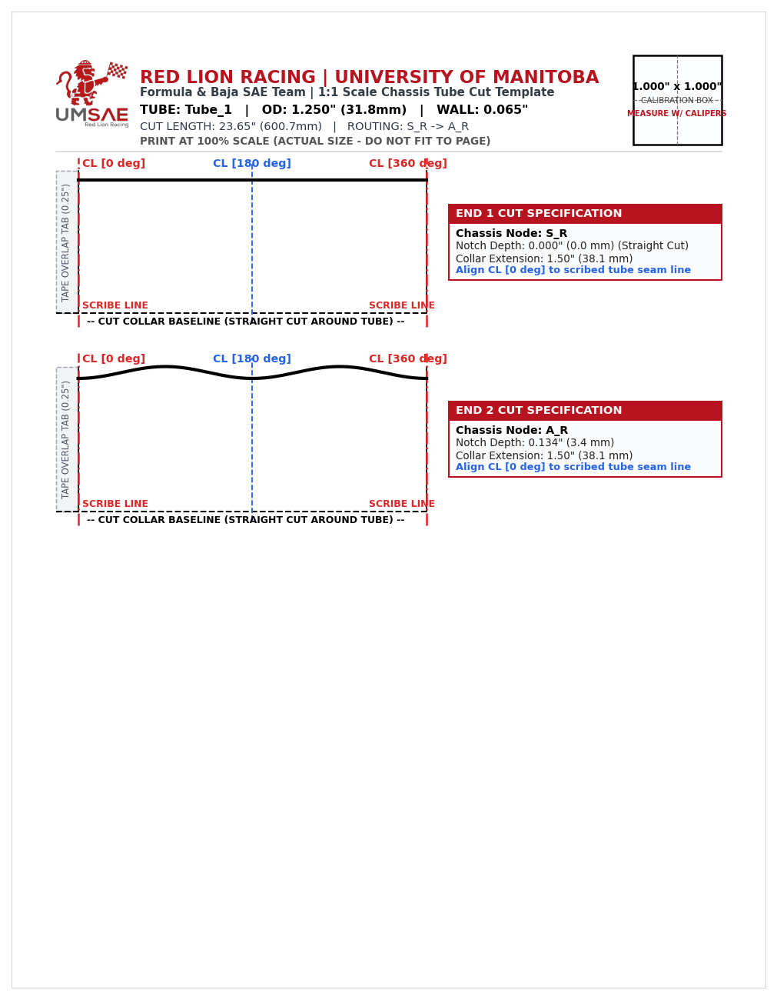

# Red Lion Racing — SolidWorks 1:1 Tube Cut Template Generator

[](https://www.solidworks.com/)
[](https://dotnet.microsoft.com/)
[]()
[]()

A native SolidWorks C# .NET Add-in designed for collegiate race teams (Formula & Baja SAE) and chassis fabricators to generate true 1:1 scale printable coping wraps (fishmouth templates), layered DXF profiles, and SVG vectors directly from SolidWorks parts and weldment assemblies.

---

## Overview

When fabricating tubular spaceframe chassis, notched and coped tube joints require precise fitment before tack welding. Manual measuring or paper wrapping from generic web calculators often suffers from incorrect printer scaling, missing rotational clocking seams, or excessive paper waste.

This add-in integrates directly into SolidWorks to inspect round tube bodies, extract cut boundaries, and produce ready-to-print wraps on standard US Letter paper (8.5" x 11.0").



---

## Key Capabilities

- **True 1:1 Physical Scale (Vector PDF):** Generated at exact physical point dimensions ($72\text{ points} = 1.000\text{ inch}$) with zero page-fit scaling distortion.
- **1.000" x 1.000" Calibration Box:** Embedded measurement target with crosshairs for shop-floor verification with vernier calipers before wrapping tubes.
- **Continuous 0° / 180° Clocking Reference:** A single continuous radial reference line shared across both ends of the tube. Scribe one straight line along the tube blank to index both notches with zero angular clocking error.
- **Paper-Saving Straight Collar:** User-configurable collar extension (default `1.50"` / `38.1 mm`) around each notch so both tube ends fit neatly onto a single letter sheet without printing unneeded tube length.
- **Spike-Free Unrolling:** Topological perimeter parameterization over monotonic angle $\theta \in [0, 2\pi]$ queried on a 360-point grid, avoiding sawtooth artifacts.
- **Multi-Format Export:** Produces printable vector PDF, layered AutoCAD R12/2000 DXF, and physical-dimension SVG.
- **Single-Click Installer:** Includes a standalone installer GUI that performs per-user COM registration without requiring administrator privileges.

---

## Repository Structure

```text
├── SolidWorks_TubeCutTemplate_Addin/
│   ├── SwAddin.cs                        # SolidWorks ISwAddin COM entry point
│   ├── UI/
│   │   └── TubeTemplatePMPPage.cs        # PropertyManagerPage interface handler
│   ├── Core/
│   │   ├── Models/TubeModels.cs          # Geometric models & vector math
│   │   ├── Geometry/
│   │   │   ├── TubeBodyAnalyzer.cs       # Cylindrical skin detection & OD analysis
│   │   │   └── CutEdgeExtractor.cs       # 3D cut edge extraction
│   │   ├── Unroller/
│   │   │   └── SpikeFreeUnroller.cs      # Monotonic unwrapping engine
│   │   └── BSAE/
│   │       └── BsaeRbfPolicy.cs          # Chassis node & rule reference helper
│   ├── Export/
│   │   ├── PdfTemplateExporter.cs        # Standalone vector PDF generation
│   │   ├── DxfTemplateExporter.cs        # AutoCAD DXF export
│   │   └── SvgTemplateExporter.cs        # SVG export
│   ├── Installer/
│   │   ├── MainForm.cs                   # WinForms graphical installer
│   │   └── InstallerCore.cs              # Self-extracting per-user COM registration
│   ├── StandaloneDemo/
│   │   └── Program.cs                    # CLI verification runner
│   └── Resources/
│       └── red_lion_logo.png             # Team logo asset
├── sample_models/                        # Sample chassis STEP models for testing
├── docs/                                 # Documentation assets and previews
├── SolidWorks_TubeCutTemplate_Addin.sln  # Visual Studio solution file
├── .gitignore                            # Git exclusion rules
└── README.md                             # Repository documentation
```

---

## Installation & Setup

### Option 1: Standalone Installer (Recommended for Fabricators & Team Members)
1. Download `RedLionRacing_SolidWorks_TubeTemplates_v1.0.zip` from the [Releases page](https://github.com/WiteLEoparD/Tube-Coping-Template-Plugin-for-Solidworks/releases).
2. Extract the archive on your machine.
3. Run `RedLionRacing_TubeTemplates_Installer.exe` (or `Install_OneClick.bat`).
4. Click **Install Add-in** (registers per-user in `HKCU`, zero admin rights needed).
5. Launch SolidWorks. The **Tube Templates** button will appear in the CommandManager under both the **Weldments** and **Assembly** tabs.

### Option 2: Building from Source
1. **Clone the repository:**
   ```bash
   git clone https://github.com/WiteLEoparD/Tube-Coping-Template-Plugin-for-Solidworks.git
   cd Tube-Coping-Template-Plugin-for-Solidworks
   ```
2. **Prerequisites:**
   - Windows 10 or 11 (64-bit)
   - SolidWorks 2022 – 2026
   - .NET Framework 4.8 Developer Pack
   - Visual Studio 2022 or .NET CLI
3. **Build:**
   Run the automated build script:
   ```powershell
   .\build.ps1 -Configuration Release -Platform x64
   ```
   Or build directly with the .NET CLI:
   ```powershell
   dotnet build SolidWorks_TubeCutTemplate_Addin.sln -c Release -p:Platform=x64
   ```

---

## How to Use in SolidWorks

1. Open your chassis part (weldment) or assembly file in SolidWorks.
2. Click the **Tube Cut Templates** button in the CommandManager ribbon.
3. In the PropertyManagerPage:
   - Select individual tube bodies in the viewport, or check **Select All Chassis Tubes** to auto-detect round tubes (0.75" to 1.75" OD).
   - Adjust the **Paper-Saving Collar** length if needed (default: `1.50"` / `38.1 mm`).
   - Choose desired output formats (**PDF**, **DXF**, **SVG**).
   - Select an output directory.
4. Click **Generate Templates**.
5. Print the PDF sheets at **100% scale (Actual Size / Do Not Scale)** and verify the calibration square with calipers before cutting.

---

## Engineering Methodology

### 1. Cylindrical Skin Detection
The add-in iterates through all faces of a selected solid body, queries underlying surface geometry using `ISurface::IsCylinder`, and clusters faces sharing an identical radius, axis vector, and centerline. The group with the largest total area is classified as the outer tube skin.

### 2. Edge Topology Filtering
An edge is retained as a cut edge if and only if it is shared by the outer cylinder skin and a non-outer face (such as a miter plane, inner bore, or coped saddle face). Internal CAD longitudinal seam lines are automatically filtered out.

### 3. Shared Clocking Vector
A reference vector $\vec{u}$ perpendicular to the tube axis $\vec{A}$ is determined via global coordinate projection:
$$\vec{u} = \frac{\vec{Z}_{\text{global}} - (\vec{Z}_{\text{global}} \cdot \vec{A})\vec{A}}{\|\vec{Z}_{\text{global}} - (\vec{Z}_{\text{global}} \cdot \vec{A})\vec{A}\|}$$
*(If the tube is aligned with the global Z axis, the Y axis is used as the projection reference).*

Both End 1 and End 2 share this vector as $\theta = 0$, guaranteeing that scribing a single straight line along the tube blank indexes both notches accurately.

---

## Team & Attribution

Developed for **UMSAE Red Lion Racing** at the **University of Manitoba** for Formula & Baja SAE chassis fabrication.
